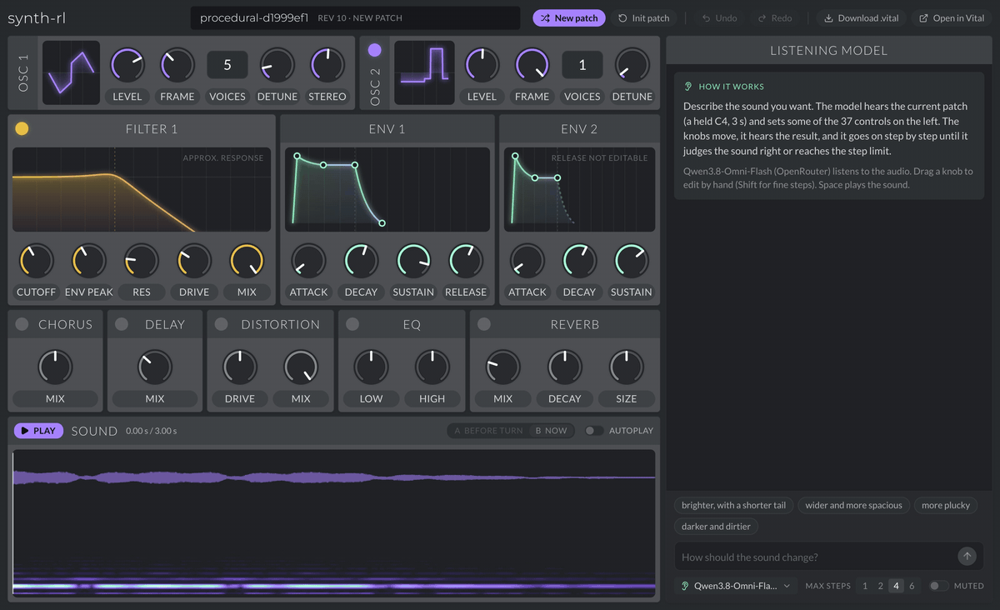

# synth-rl

Audio-LLM agents that program a synthesizer. Describe a change in words ("brighter, with a shorter tail") or hand over a recording, and an agent listens, turns the knobs of [Vital](https://vital.audio), listens to its own result, and writes out a preset you can open in Vital.

In the first measurements here, current models do this poorly when the answer is only in the audio. So the repository also holds the environment to measure that: a benchmark scored on the sound each agent actually produces, and a GRPO recipe that fine-tunes Qwen Omni models with LoRA against that reward.



The demo ([`demo/`](demo/README.md), started with `demo/run.sh`) is a local page with the 37 controls the agent can set, a chat, and the sound. The model sets knobs, hears its own result, and stops when the sound fits; any turn can be rerun with silent audio to see what the audio changed.

Vital runs headless through the [`vita`](https://github.com/DBraun/Vita) Python bindings, which ship Linux, macOS, and Windows wheels. Rendering a 3-second note takes about 0.05 s on one CPU core.

## Use it

```sh
uv venv --python 3.12 && uv pip install -e .              # add ".[train]" for local models and training
export GEMINI_API_KEY=...

synth-rl edit --preset my.vital --instruction "brighter, with a shorter tail"
synth-rl match --target note.wav                           # one note at middle C, up to 3 s
```

- **`edit`** changes a preset to follow an instruction. The agent hears the sound, edits, hears its own result, and refines it (two rounds by default).
- **`match`** builds a patch that sounds like a recording, starting from Vital's init patch (or from `--preset`).

Both print each round's changes and reasons, and write the result to `--out` (default `outputs/edit` or `outputs/match`):
- `final.vital`: the edited preset, ready to open in Vital;
- `round0_before.wav` and `final.wav`: the sound before and after;
- `result.json`: every prompt, reply, and change.

`--agent` takes a Gemini model id (the default, `gemini-3.8-flash`), a local Qwen Omni model as a Hugging Face id or folder (`Qwen/Qwen2.5-Omni-7B`, `Qwen/Qwen3-Omni-30B-A3B-Instruct`), a fine-tuned LoRA as `<model>::<adapter folder>`, or `rule`, a keyword baseline that never listens.

## How it works

The benchmark and the training run on generated tasks:

1. **Starting sound.** By default each task starts from a procedurally generated patch (random oscillators, filter, envelopes, envelope-to-cutoff modulation, and effects, built from Vital's init preset), so no third-party presets are needed and renders are bit-exact. Generated patches carry a wavetable of five basic shapes, so the wavetable position runs from sine through triangle, saw, and square to a narrow pulse, and both oscillators pass through the filter. Any folder of `.vital` presets works too.
2. **Task.** There are three kinds:
   - **edit:** the patch and an instruction it can still satisfy (a sound that is already fully dry gets no "make it drier").
   - **repair:** 2–4 parameters of the patch take values from another generated patch (so they look no less plausible than the rest), redrawn until the sound differs by a minimum spectral distance; the agent hears the broken sound and the original and must restore it.
   - **match:** the agent starts from Vital's init patch, hears the target, and must rebuild it from scratch. Every procedural target is reachable exactly through the editable controls (a preflight check rebuilds targets from their values).
3. **Observation.** The agent sees 37 curated controls (oscillators, filter, envelopes, effects), one line each: the current value with its unit, the allowed range, and what the control does, e.g. `filter_1_cutoff: 615 Hz (13 to 21100 Hz)`. It also gets the instruction and the rendered audio (plus the target for repair and match). In the **blind** variant the current values are hidden, so the agent has to infer them by listening.
4. **Action.** JSON edits in the listed units: `{"edits": {"filter_1_cutoff": 800, "env_1_decay": 0.3, "reverb_on": "off"}, "reason": "..."}`. Values outside a range are clipped to it. Envelope 2 moves the filter between two cutoffs the agent sets directly, `filter_1_cutoff` (envelope at zero) and `filter_1_cutoff_at_env_2_peak` (envelope at its peak); a lower peak closes the filter on each note, and equal values mean no movement.
5. **Reward.** The environment applies the edits, renders, and computes timbre descriptors: spectral centroid, high-frequency energy, peak level, attack time, sustain ratio, release tail, and stereo width.
   - **Edit reward:** the `tanh`-shaped signed change of the descriptors the instruction targets, minus drift in descriptors it should leave alone, minus level drift beyond 3 dB, minus a small penalty for touching many parameters. Leaving the sound unchanged scores exactly 0.
   - **Repair and match reward:** the relative improvement in multi-resolution STFT distance to the target, `tanh`-shaped.

**One reply or a loop.** By default an agent answers once. This is the diagnostic setting: nothing in it depends on what the agent chooses to do, so the muted-audio comparison changes the audio and nothing else. `--rounds N` repeats it N times on the latest render, each round a fresh prompt.

`--steps N` runs the step loop of `synth_rl/loop.py` instead, one conversation per task. Each reply is `{"set": {"filter_1_cutoff": 800, ...}, "reason": "..."}` with any number of parameters; the environment answers with what changed and the audio of the new sound; the agent goes on until it replies `{"done": true}` or N steps have passed. The clip of every result is always given, so a muted run is again the same messages with silent clips. Every step records the task reward before and after it.

## Benchmark

```sh
synth-rl bench --agents rule --n 30                        # keyword baseline that never listens
synth-rl bench --agents gemini-3.8-flash --n 30
synth-rl bench --agents Qwen/Qwen2.5-Omni-7B --n 30        # local Qwen Omni (Hugging Face id or folder)
synth-rl bench --agents Qwen/Qwen2.5-Omni-7B --mute-audio  # same prompts with silent audio
synth-rl bench --agents Qwen/Qwen2.5-Omni-7B --blind       # hidden parameter values
synth-rl bench --kind repair --agents ...                  # restore a broken sound
synth-rl bench --kind match --agents ...                   # rebuild a target sound from the init patch
synth-rl bench --agents openrouter:qwen/qwen3.8-omni-flash --steps 6   # step loop: set, hear the result, go on until done
synth-rl demo --agent gemini-3.8-flash --rounds 2          # full trajectories: prompt, reply, changes, audio
```

`bench` saves its task set to `<out>/tasks.jsonl` and appends to `<out>/results.jsonl`, so agents can be run one at a time (large local models never share memory) and compared on identical tasks. Parallel runs write separate files with `--results <out>/parts/<name>.jsonl`; `synth-rl summary --out <out>` merges them. `--presets ~/Music/Vital` switches from procedural patches to a preset folder; scores then average three renders per state, because presets with free-running LFOs or random modulators do not render identically. `synth-rl rescore --out <dir>` recomputes rewards from stored edits after a reward change. Local Omni models hear 16 kHz mono, so `--specs mono` (the default for training) drops the stereo-width instructions.

## Training

`synth_rl/grpo.py` trains a LoRA on the language model of a Qwen2.5-Omni or Qwen3-Omni thinker with GRPO:

- Each step samples fresh procedural tasks (edit, repair, and match in equal shares by default; `--kinds` selects), draws `--group` completions per task at temperature 1, and scores every completion by rendering it. Replies may run to `--max-new-tokens` 512, enough to set every control for a match.
- Advantages are the group-normalized rewards. Groups whose completions all score the same carry no signal and are skipped.
- One gradient step is taken per batch, so the update is on-policy. An optional KL penalty to the base model is available (`--kl`).
- Unparseable replies score −3, below every real attempt (real edit rewards are bounded below by about −2.4).
- Evaluation on a fixed task set runs every `--eval-every` steps, both with the real audio and with silence, and reports each task kind separately. The gap between the two shows how much the score depends on the audio. The first evaluation, before any update, is the base model.
- Checkpoints are atomic. Rerunning the same command resumes.

```sh
python -m synth_rl.grpo --model models/Qwen2.5-Omni-7B --out runs/edit-7b              # one GPU (or MPS/CPU)
torchrun --nproc_per_node 8 -m synth_rl.grpo --model models/Qwen2.5-Omni-7B --out runs/edit-7b
python -m synth_rl.grpo ... --blind                                                     # hide parameter values too
```

Outputs:

- `log.jsonl`: per-step reward (overall and per task kind), validity, skipped groups, completion length, loss, gradient norm, and timings; evaluations.
- `samples.jsonl`: example completions.
- `best/` and `final/`: LoRA adapters.

Benchmark an adapter with `--agents <model>::<adapter dir>`.

**One command on a fresh GPU machine.** `scripts/run_all.sh` runs everything in order:

1. Installs the pinned environment with uv.
2. Downloads the model from Hugging Face.
3. Runs preflight checks (`synth_rl/preflight.py`) and stops on any failure:
   - rendering is deterministic;
   - reward edge cases score correctly;
   - reward worker processes agree with the main process;
   - the model's replies parse;
   - two training steps on every GPU, a resume, and a benchmark of the saved adapter.
4. Starts training in the background. On errors it restarts from the last checkpoint until the time budget is used.
5. Benchmarks the keyword baseline, the base model, and the adapter on fixed edit, repair, and match sets, with and without audio, spread over the GPUs, and packs logs, adapters, and benchmark results into `runs/<name>/results.tar.gz`. The last 1.5 hours of the budget are kept for this (`EVAL_RESERVE`, in seconds). `--hours` counts from the start of the command, so installation, download, and preflight count against it.

```sh
scripts/run_all.sh --model Qwen/Qwen2.5-Omni-7B --hours 20
scripts/run_all.sh --model Qwen/Qwen2.5-Omni-3B --gpus 1 --hours 4 -- --blind
```

When huggingface.co or pypi.org cannot be reached, `run_all.sh` switches to mirrors by itself. To choose them yourself, set them before running, for example `export HF_ENDPOINT=https://hf-mirror.com UV_DEFAULT_INDEX=https://pypi.tuna.tsinghua.edu.cn/simple PIP_INDEX_URL=https://pypi.tuna.tsinghua.edu.cn/simple`, or pass a local model folder as `--model`.

If a run fails or stalls, `scripts/doctor.sh runs/<name>` collects the GPUs, driver, packages, network, and log tails into `runs/<name>/doctor.txt`. [AGENTS.md](AGENTS.md) lists the log files, common failures, and their fixes, for a person or a coding agent.

Estimated memory per GPU (not yet measured on CUDA):

- **Qwen2.5-Omni-7B (bf16, LoRA, gradient checkpointing):** about 40 GB with the default batch sizes.
- **Qwen2.5-Omni-3B:** about 9 GB of weights; 24 GB cards should work with smaller batches, such as `--gen-batch 16 --micro-batch 2`.
- **Qwen3-Omni-30B-A3B:** holds the full 60 GB model on each GPU. The fused MoE experts take no LoRA, so only attention layers are adapted. Lower `--gen-batch` and `--micro-batch` on 80 GB cards.

### Other RL frameworks

`synth_rl/rl.py` exposes the reward with the signatures these frameworks expect:

- `compute_score`: verl's custom-reward signature.
- `SynthEditORM`: ms-swift's outcome-reward plugin interface (not yet tested against ms-swift).

`synth-rl export` writes single-turn prompts with rendered audio for frameworks that read datasets from disk. Each row carries the starting state, so reward workers re-render from scratch.

For multi-step training, `synth_rl/loop.py` is the environment side, about 150 lines and no framework:

- `Episode(env, task)` holds `messages` in OpenAI chat format and has `step(reply)`. A step is an assistant message with the JSON action, then a user message with the result text and the new clip, so the same conversation works through an API and through a local model's chat template without tool-calling support.
- `rollout(agent, env, task, max_steps)` runs an episode with any agent that has `complete(messages) -> str` (the OpenAI-compatible agent and the local Qwen Omni agent do) and returns the record: final score, per-step `reward_before` and `reward`, and the conversation.
- `as_tool_calls(record)` rewrites a record into assistant `tool_calls` and `tool` messages, with the JSON schema of the one tool, `set` (every parameter with its unit and range), for trainers that expect that form. The clip stays in a user message, because tool messages carry text only in that format. Checked once against the API (the model answers with a `set` call whose arguments read as edits, then stops after hearing the result); not yet fed to a trainer.

Training on these trajectories is not implemented: `grpo.py` trains on single replies.

## Early measurements (zero-shot, no training)

These are small first checks: one model (Qwen3.8-Omni-Flash through OpenRouter, reasoning off, temperature 0.7), 40 edit and 40 repair tasks, one episode per task. They say more about the environment than about models, and the rewards are still being worked on (see Status).

**Do the rewards order actions correctly?** `python scripts/reward_checks.py` scores actions whose quality is known by construction. No model is involved.

| Action on a repair task | Mean reward |
|---|---|
| Leave the sound alone | 0 |
| Every wrong parameter moved half as far again away from its target | −0.47 |
| Every wrong parameter moved a quarter of the way to its target | +0.32 |
| Half of the way | +0.62 |
| Three quarters of the way | +0.87 |
| The full repair, written as an agent writes it | +0.99 |
| One parameter that was right moved by a quarter of its range | −0.17 |

- The repair reward rises on the way from the broken sound to the target; in 33 of 40 tasks it never falls. It saturates early, and tiny moves of four parameters (reverb size, either unison detune, filter mix) can shift it by a large amount.
- The edit reward can be earned without listening. A keyword rule that reads only the request scores 0.70, above the model's 0.55, so edit scores say nothing about whether a model listens.

**One reply against the step loop.** Mean reward on the same tasks. The loop was allowed 6 steps; "muted" sends the same messages with silent clips.

| Setting | Edit | Repair |
|---|---|---|
| One reply | 0.551 | −0.234 |
| One reply, muted | 0.525 | −0.755 |
| Step loop | 0.640 | −0.378 |
| Step loop, muted | 0.611 | −0.712 |

- On repair the model ends below 0, the score of leaving the sound alone, in every row. Every episode that scored below 0 had moved parameters that were already right; in one reply the model moves 1.5 of them per task with audio and 4.2 with silent clips.
- Silent clips lower the repair score (by 0.52, 95% interval 0.32 to 0.71, one reply) and make no measurable difference on edits (0.03, −0.09 to 0.15). So the audio changes what the model does on repair. Whether that is hearing put to use is not established: the visible difference is that it moves fewer parameters.
- The loop brought no measurable gain (edit +0.09, −0.00 to +0.21; repair −0.14, −0.35 to +0.06). The model usually changes the sound once and then stops.

To rerun: `python scripts/loop_vs_one_reply.py run`, then `report`.

**Listening, a first look.** A small probe (`python scripts/listening_probe.py`) plays two clips that differ in one parameter and asks "which clip is brighter?" and the like. Over 144 pairs the model picked the right clip in 71% (95% interval 63–78%), against 41% with silent clips; with small differences it was near chance. That is one model, one wording of the question, and one reply per pair. It suggests the model can tell large differences apart when asked to compare. It does not show how the model uses audio while editing, and a measure of that is not built.

Runs from October 2026 with Gemini and local Qwen Omni models, including their comparison with silent audio, are in [docs/earlier-runs.md](docs/earlier-runs.md). They used an older patch generator and prompt format and are not comparable with the numbers above.

## Status

Early. Known limitations:

- **The reward signal is not settled.**
  - The edit reward is built from hand-set descriptor thresholds and weights. It can be earned from the text of the request, it rewards bigger moves in the requested direction until `tanh` saturates, and it has known blind spots: "wider" can reward detuned, wobbling unison, and "brighter" can reward added distortion.
  - The repair and match reward orders actions correctly in the checks above, but it saturates early and is over-sensitive to four parameters.
  - A request in free words, as in the demo's chat, has no reward at all. The likely route is a model that judges the sound against the request and is checked against the synthesizer's ground truth. It is not built.
  - No reward measures whether the model used the audio. The comparison with silent clips is the only handle on that so far.
- **No training run has finished.** The GRPO pipeline has been run end to end on a Mac (Qwen2.5-Omni-3B: preflight, a few training steps, resume, benchmark) and for a few steps with Qwen3-Omni-30B, but not on CUDA GPUs, so there are no trained results and the memory figures above are estimates.
- Generation uses Hugging Face `generate`. A vLLM rollout backend would make sampling several times faster, but audio-input support for these models in vLLM still has to be checked.
- Creating a sound from a text description alone ("a warm, slowly evolving pad") is not covered yet. Match tasks cover creation from a reference sound.

## License

GPL-3.0-or-later, following Vital.
