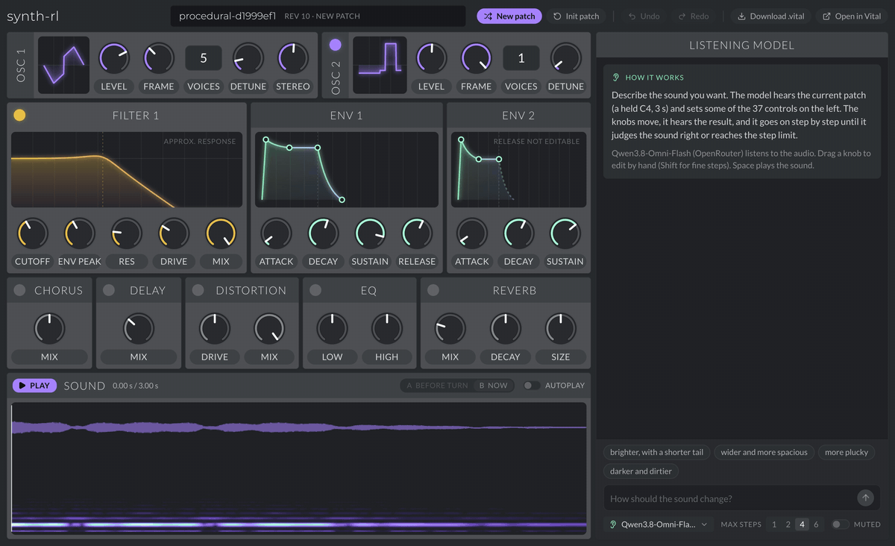

# synth-rl demo

A local page where you tell a listening model how a sound should change and watch it turn the knobs.



Left: the 37 controls the agent can edit, in a panel styled after Vital. Right: the chat. Below: the sound
(waveform, spectrogram, before/after). A round's card says so when its changes left the audio identical or made it much quieter.

## Run

```sh
uv pip install -e ".[demo]"          # once: fastapi, uvicorn, sse-starlette
export OPENROUTER_API_KEY=...        # for the listening model; without it only the keyword rule works
demo/run.sh                          # then open http://127.0.0.1:8765
demo/run.sh --vital                  # same, plus the real Vital window following the page (macOS, Vital 1.5.5 VST3)
```

`run.sh` builds the page with pnpm on its first run (Node and pnpm needed) and serves it from `demo/web/dist`.

## What is what

- **State, audio, and measurements** come from `synth_rl.vital_env.VitalEnv`, the same headless Vital the benchmark
  uses. Each chat message is one episode of the repository's step loop (`synth_rl/loop.py`): the model gets the
  parameter list and the rendered audio and replies with the parameters to set; the server applies and renders them
  and answers with what changed and the new audio; the model goes on, seeing its earlier steps, until it replies
  that it is done or reaches the step limit set in the composer.
- **Agents**: `openrouter:qwen/qwen3.8-omni-flash` (reasoning off, about 2.5 s per step), the same with `+think`
  (reasoning on, 12 s or more per step), and `rule`, a keyword baseline that never listens.
- **Muted**: sends the same prompt with silent audio. "Compare with muted audio" reruns a turn that way from the
  same starting sound and shows both results.
- **Real Vital window** (`demo/mirror/`): one-way. It shows the server's state; knobs turned there are not sent
  back, and it plays nothing. "Open in Vital" instead starts a separate Vital with the current preset loaded.

Sounds are generated patches or Vital's init patch. Their oscillators use a wavetable of five shapes: the Frame knobs run from sine (0) through triangle, saw, and square to a narrow pulse (1). `DESIGN.md` has the API contract and the known limits.
`demo/tests/acceptance.py` checks the API with both agents.
